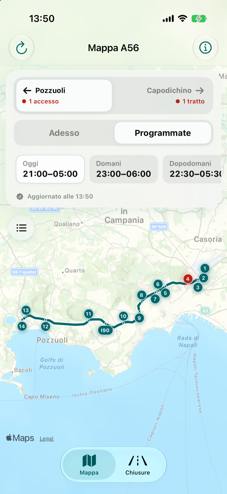
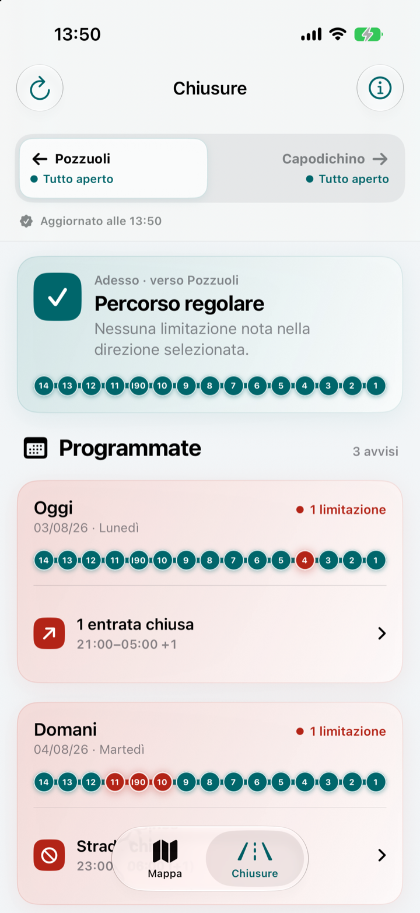

# A56 Tangenziale Napoli

[Italiano](README.md) · **English**

An independent iOS app for checking current and scheduled closures on the A56 Tangenziale di Napoli.

The app turns the operator's public traffic feeds into a clear view of closed carriageway sections and affected entrances or exits. It is designed for a quick check before travelling, with both a geographic map and a direction-based closure list.

<p align="center">
  
  
</p>

## Highlights

- Current and scheduled closures, split by direction
- Separate treatment of blocked carriageway sections and closed ramps
- Interactive MapKit overview with real A56 geometry
- **Routes** tab with address search, optional location and driving comparisons with and without the A56
- Detailed closure cards with time window, cause and affected interchanges
- Saved notices available offline and clearly marked for verification
- Local archive with configurable retention and in-app deletion
- No account, analytics, advertising or API keys
- Accessibility labels and Reduce Motion support

## Technical overview

A56 Tangenziale Napoli is built entirely with Apple frameworks and has no third-party dependencies.

- **UI:** SwiftUI
- **Maps:** MapKit with an OpenStreetMap-derived A56 overlay
- **State:** Observation and a small MVVM-style view model layer
- **Networking:** async/await with independent planned and real-time feed requests
- **Persistence:** Codable snapshots stored locally on the device
- **Minimum target:** iOS 18.0

The source is organised by responsibility:

```text
TangenzialeNapoli/
├── Data/          Feed decoding, mapping, route geometry and local archive
├── Models/        A56 and closure domain models
├── Utilities/     Formatting, logging and visual tokens
├── ViewModels/    Loading, fallback and presentation state
└── Views/         SwiftUI screens and reusable components
```

## Data pipeline

Traffic data comes from the two public JSON feeds behind Autostrade per l'Italia's viability pages: `previsioni.json` for planned events and `eventi.json` for real-time ones.

On every refresh, A56 records are validated and mapped onto the app's fixed interchange topology; planned and live events are then merged without losing the published schedule. The last valid result stays on the device to cover temporary network failures.

The app checks the feed publication date and refreshes notices periodically while open. Incomplete or expired data cannot confirm that the road is clear. All notice times use Naples time, including on devices set to a different time zone.

In the **Routes** tab, Apple Maps calculates alternatives and the app checks which ones follow the A56. Traffic notices are checked against the affected sections, direction of travel and estimated trip window. A closure near an inferred entrance or exit is flagged for verification. If Apple Maps does not offer both alternatives, the app indicates which one is missing.

The integration is unofficial and the feeds are not a documented or guaranteed public API. The app clearly marks stale or incomplete data and directs users to the operator's channels for confirmation.

## Run locally

Requirements:

- macOS with Xcode 26 or later
- an iOS 18 or later simulator/device

Clone the repository, open `TangenzialeNapoli.xcodeproj`, select your own development team if you are running on a physical device, then build the `TangenzialeNapoli` scheme. Simulator builds do not require code signing or credentials.

For deterministic Debug builds, these launch arguments are available:

- `--sample-data` loads local sample closures;
- `--stale-sample-data` shows the cached-data state;
- `--unavailable-data` shows the unavailable-data state;
- `--show-closures` opens the closure list instead of the map.

On macOS, run `Tests/check-a56.sh` to check closure mapping, A56 route recognition, incomplete feeds and cache fallback.

## Privacy and safety

The app does not create accounts or include analytics or advertising SDKs. It requests location access when you select **Use my location** or tap a favorite destination to check the route. Apple Maps uses the addresses and coordinates to calculate routes. The app stores the destinations you add to favorites, preferences and cached traffic notices on the device. Network providers can still receive standard connection information such as an IP address under their respective privacy policies.

A56 Tangenziale Napoli is an independent informational project. It is not affiliated with, sponsored by or approved by Autostrade per l'Italia or Tangenziale di Napoli. Traffic information can be delayed, incomplete or changed at short notice. Always check the operator's official channels and follow road signs, staff and authorities. Never interact with the app while driving.

[Privacy policy (Italian)](docs/privacy.md) · [App Store preparation (Italian)](docs/release.md)

## Attribution and licence

The application source code is available under the [MIT License](LICENSE).

The A56 route overlay is derived from [OpenStreetMap](https://www.openstreetmap.org/copyright) data and is subject to the Open Database License (ODbL). The base map is provided by Apple Maps under Apple's applicable terms. Company and product names belong to their respective owners.

Copyright © 2026 Giovanni Monaco.
