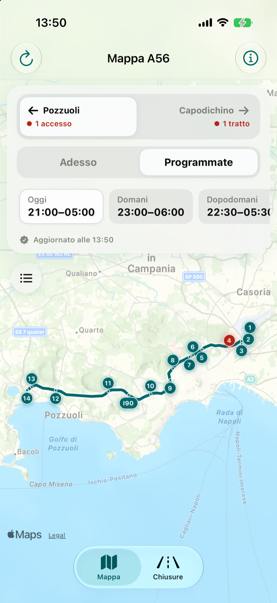
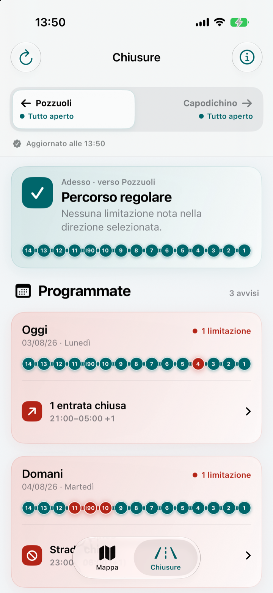

# A56 Tangenziale Napoli

**Italiano** · [English](README.en.md)

Un’app iOS indipendente per consultare le chiusure in corso e programmate sulla A56 Tangenziale di Napoli.

L’app trasforma i flussi pubblici del gestore in una vista chiara dei tratti autostradali interrotti e degli ingressi o delle uscite interessati. È pensata per un controllo rapido prima di partire, attraverso una mappa geografica e un elenco delle chiusure diviso per direzione.

<p align="center">
  
  
</p>

## Funzionalità principali

- Chiusure in corso e programmate, divise per direzione
- Distinzione tra tratti autostradali interrotti e rampe chiuse
- Mappa MapKit interattiva con il tracciato reale della A56
- Schede dettagliate con orari, causa e svincoli interessati
- Funzionamento offline basato sull’ultimo aggiornamento valido salvato sul dispositivo
- Archivio locale con durata configurabile
- Nessun account, permesso di localizzazione, sistema di analytics, pubblicità o chiave API
- Etichette di accessibilità e supporto a Riduci movimento

## Dettagli tecnici

A56 Tangenziale Napoli è sviluppata interamente con framework Apple e non utilizza dipendenze di terze parti.

- **Interfaccia:** SwiftUI
- **Mappe:** MapKit con tracciato A56 derivato da OpenStreetMap
- **Stato:** Observation e un’architettura leggera ispirata a MVVM
- **Rete:** async/await con richieste indipendenti per dati programmati e in tempo reale
- **Persistenza:** snapshot Codable salvati localmente sul dispositivo
- **Versione minima:** iOS 18.0

Il codice sorgente è organizzato per responsabilità:

```text
TangenzialeNapoli/
├── Data/          Decodifica dei feed, mapping, geometria e archivio locale
├── Models/        Modelli di dominio della A56 e delle chiusure
├── Utilities/     Formattazione, logging e token visivi
├── ViewModels/    Caricamento, fallback e stato di presentazione
└── Views/         Schermate SwiftUI e componenti riutilizzabili
```

## Flusso dei dati

L’app consulta due feed JSON pubblicamente accessibili utilizzati dalle pagine di viabilità di Autostrade per l’Italia:

1. eventi programmati da `previsioni.json`;
2. eventi in tempo reale da `eventi.json`;
3. validazione e associazione dei dati A56 alla topologia fissa degli svincoli;
4. unione degli eventi programmati e in corso senza perdere gli orari pubblicati;
5. salvataggio locale dell’ultimo risultato valido per gestire interruzioni temporanee della rete.

L’integrazione non è ufficiale e i feed non costituiscono un’API pubblica documentata o garantita. L’app segnala chiaramente dati non aggiornati o incompleti e rimanda ai canali del gestore per la verifica.

## Esecuzione locale

Requisiti:

- macOS con Xcode 16 o successivo
- simulatore o dispositivo con iOS 18 o successivo

Clona la repository, apri `TangenzialeNapoli.xcodeproj` e compila lo schema `TangenzialeNapoli`. Per eseguire l’app su un dispositivo fisico, seleziona il tuo team di sviluppo nelle impostazioni del progetto. Il simulatore non richiede firma del codice o credenziali.

Per ottenere stati deterministici nelle build Debug sono disponibili questi argomenti di avvio:

- `--sample-data` carica chiusure di esempio locali;
- `--stale-sample-data` mostra lo stato con dati non aggiornati;
- `--unavailable-data` mostra lo stato con dati non disponibili;
- `--show-closures` apre l’elenco delle chiusure al posto della mappa.

## Privacy e sicurezza

L’app non crea account, non richiede la posizione e non integra sistemi di analytics o pubblicità. Salva soltanto la direzione selezionata e una cache locale degli avvisi. I fornitori dei servizi di rete possono comunque ricevere normali informazioni di connessione, come l’indirizzo IP, secondo le rispettive informative sulla privacy.

A56 Tangenziale Napoli è un progetto informativo indipendente. Non è affiliato, sponsorizzato o approvato da Autostrade per l’Italia o Tangenziale di Napoli. Le informazioni sul traffico possono essere in ritardo, incomplete o cambiare con breve preavviso. Prima di partire verifica sempre i canali ufficiali del gestore e segui la segnaletica, il personale e le autorità presenti sulla strada. Non interagire con l’app mentre guidi.

## Attribuzioni e licenza

Il codice sorgente dell’applicazione è distribuito con [licenza MIT](LICENSE).

Il tracciato della A56 deriva dai dati di [OpenStreetMap](https://www.openstreetmap.org/copyright) ed è soggetto alla Open Database License (ODbL). La cartografia di base è fornita da Mappe Apple secondo le condizioni applicabili. Nomi di aziende e prodotti appartengono ai rispettivi titolari.

Copyright © 2026 Giovanni Monaco.
